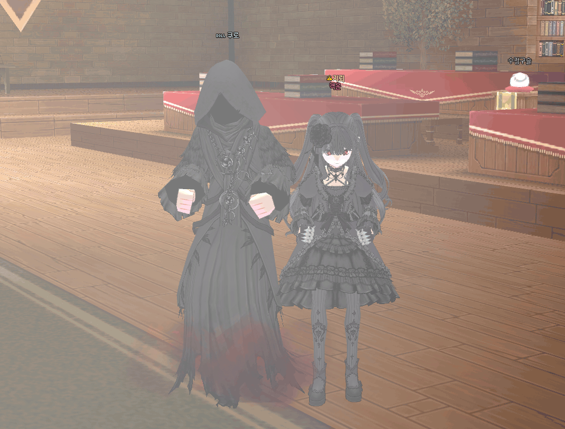

# ClipCam

画面の好きな範囲を録画して、GIF / MP4 で保存できる Windows 用の録画ツールです。
「範囲を選ぶ → 録画 → 簡単に編集 → 保存」までを 1 つの exe で手軽に行えることを目指して作成しました。

> ※ 現在、画面の表示言語は韓国語のみです。

## 使用例

友人がゲームのプレイ画面の録画に実際に使用し、ClipCam で GIF に変換したものです。



## 主な機能

- **範囲選択**：画面をドラッグして録画範囲を指定（マルチモニター対応）
- **録画枠の調整**：赤い枠の上部タブをドラッグで移動、枠の辺・角をドラッグでサイズ変更（録画中は移動のみ）
- **録画**：FPS（5〜60）とマウスカーソルの有無を設定、F10 キーで開始 / 停止
- **編集**：プレビュー再生、前後のカット、フレーム削除、元に戻す（Ctrl+Z）
- **保存**：GIF（動画に合わせたパレットを生成して高画質化）/ MP4（H.264）、再生速度（0.5〜2 倍）、横幅の縮小

## 動作環境

- Windows 10（バージョン 2004 以降）/ Windows 11
- .NET Framework 4.5 以上（Windows 10 / 11 には標準で搭載）
- GIF / MP4 の保存には [FFmpeg](https://ffmpeg.org/) が必要です（本リポジトリには含まれていません）

## 使い方

1. [Releases](../../releases) から zip をダウンロードして展開
2. FFmpeg を準備（どちらか一方）
   - PowerShell で `winget install Gyan.FFmpeg` を実行
   - `ffmpeg.exe` を `ClipCam.exe` と同じフォルダに置く
3. `ClipCam.exe` をダブルクリック
   - 初回に「Windows によって PC が保護されました」と表示された場合は「詳細情報」→「実行」を選択（コード署名をしていない個人制作のツールのため）

| キー（編集画面） | 動作 |
|---|---|
| Space | 再生 / 一時停止 |
| ← → | 前 / 次のフレーム |
| Delete | 現在のフレームを削除 |
| Ctrl+Z | 元に戻す |

## 技術的なポイント

- **撮影と保存を別スレッドに分離**：撮影スレッドは決まった間隔で画面を撮ることだけを行い、PNG への保存は複数の保存スレッドが担当。上限付きのキュー（`BlockingCollection`）で、保存が追いつかない場合もメモリが増え続けないようにした
- **録画のタイミング精度**：`timeBeginPeriod(1)` でタイマー精度を上げ、実際に撮影した時刻の差から各フレームの表示時間を算出（処理が遅れても再生速度がずれない）
- **録画枠や操作バーが映り込まない**：`SetWindowDisplayAffinity`（`WDA_EXCLUDEFROMCAPTURE`）で、自分のウィンドウをキャプチャ対象から除外
- **枠のドラッグ移動・サイズ変更**：`WM_NCHITTEST` に応答して、どこをつかんだら移動 / リサイズかを OS に伝える方式。枠の内側はクリックが下のウィンドウに通る
- **マウスカーソルの合成**：`CopyFromScreen` はカーソルを撮影しないため、`GetCursorInfo` / `DrawIconEx` でカーソルの位置（ホットスポット）を補正して描画
- **GIF / MP4 変換**：FFmpeg の concat 形式でフレームごとの表示時間を渡し、GIF は `palettegen` / `paletteuse` で 256 色制限による画質低下を抑えた

## ファイル構成

| ファイル | 役割 |
|---|---|
| `src/MainForm.cs` | 開始画面と全体の流れ |
| `src/RegionSelectForm.cs` | ドラッグによる範囲選択 |
| `src/BorderForm.cs` | 録画枠（移動・サイズ変更） |
| `src/RecorderForm.cs` | 録画操作バー、撮影・保存スレッド |
| `src/ScreenCapture.cs` | 画面 1 枚の撮影とカーソル描画 |
| `src/EditorForm.cs` | 編集・プレビュー・保存画面 |
| `src/Exporter.cs` | FFmpeg による GIF / MP4 変換 |
| `src/NativeMethods.cs` | Windows API の宣言 |

## ビルド方法

Visual Studio 2022 で `src/ClipCam.csproj` を開いてビルドするか、以下を実行します。

```
cd src
dotnet build -c Release
```

## 今後の予定

- 画面の表示言語の切り替え（日本語 / 韓国語）
- 録画中の一時停止、テキストの挿入
